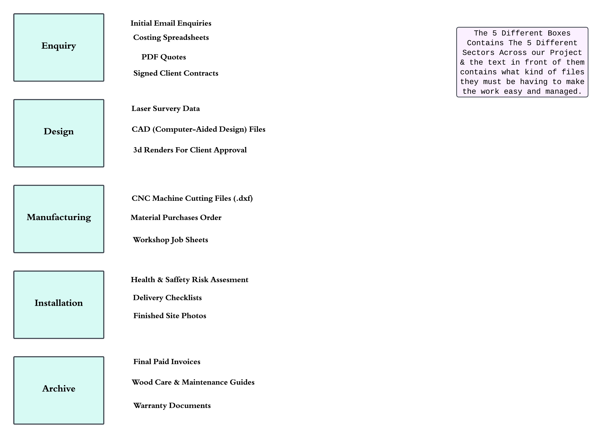

# Digital Infrastructure Blueprint: Bespoke Manufacturing

### Executive Summary
Organic business growth often leads to fragmented file storage, duplicate data, and version control risks. This repository contains a proposed digital information architecture and process map designed for a bespoke manufacturing environment. 

### Core Objectives
*   **Standardize Project Tracking:** Map the flow of data from initial customer enquiry through to final installation and archiving.
*   **Establish Information Governance:** Implement strict naming conventions and a master folder hierarchy to replace fragmented shared drives.
*   **Mitigate Version Control Risks:** Introduce standardized versioning protocols to prevent manufacturing errors caused by outdated files.

### 1. The Manufacturing Process Map
Below is the workflow mapping the five distinct phases of production and the specific data generated at each stage:

### 2. Information Architecture Rules
To maintain the integrity of the system, the following rules apply to all cloud storage and local drives:
*   **Folder Structuring:** Master folders must follow the `[Year]-[Project Number]_[Client Name]` format.
*   **Version Control:** All working files must append `_v01`, `_v02`, etc. 
*   **Approval Tags:** Only locked, approved files ready for manufacturing or client delivery may receive the `_FINAL` tag.
